# Fragile Gain

**A per-application volume mixer for PipeWire.** It lists *every* running program that uses audio — including
silent ones and nested sound sources (`Anki → mpv`) — with its own slider, a master volume, an output-device
switcher with a hotkey, and a UI in 13 languages.

[Русская версия → README.md](README.md)

<p align="center">
  <picture>
    <source media="(prefers-color-scheme: dark)" srcset="docs/screenshots/dark/overview.png">
    <source media="(prefers-color-scheme: light)" srcset="docs/screenshots/light/overview.png">
    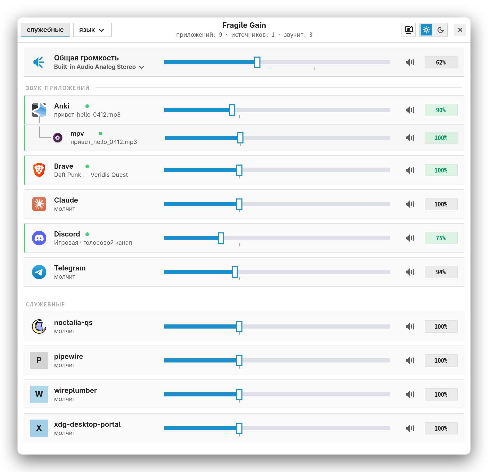
  </picture>
</p>

> Screenshots are shown in both themes. They are generated by [`docs/make_screenshots.py`](docs/make_screenshots.py) from demo data
> (fictional apps, tabs and devices), so nothing personal is shown.

## Why not pavucontrol

pavucontrol, pwvucontrol and wiremix only show applications that are playing sound **right now**. In PipeWire the
volume belongs to the *stream*, not the application: when Steam or Telegram goes quiet its stream is destroyed
and the slider disappears. Fragile Gain shows **all running applications that use audio**, silent and tray-only
ones included, and remembers the volume you set until the app starts playing again.

## Features

- **Dependency tree:** when sound comes from an application's helper (Anki launches `mpv`), the source is shown as a nested
  row. The parent's slider moves all nested sources by the same delta (Anki −5 % → mpv −5 %).
- Real **names and icons** from installed apps (`.desktop`); service processes live in a separate section.
- **What is playing:** browser tab title or track (via MPRIS), file name for mpv; otherwise *silent* / *muted*.
- **Master volume**, **output-device switcher** (moves playing streams), **hide dead outputs** so the hotkey never
  switches to an unplugged HDMI, and a configurable **hotkey**.
- Volume above 100 % (up to 300 % per app, 150 % master), highlight for playing apps, mute, mouse wheel.
- Light and dark themes; 13 languages (system language detected automatically, switch with the *language* button).
- Keyboard accessible, with accessible names for screen readers.

## Screenshots

The theme is switched with the sun / moon toggle in the header. Pick which set to view:

<details open>
<summary><b>Dark theme</b></summary>

| | |
|:--:|:--:|
| 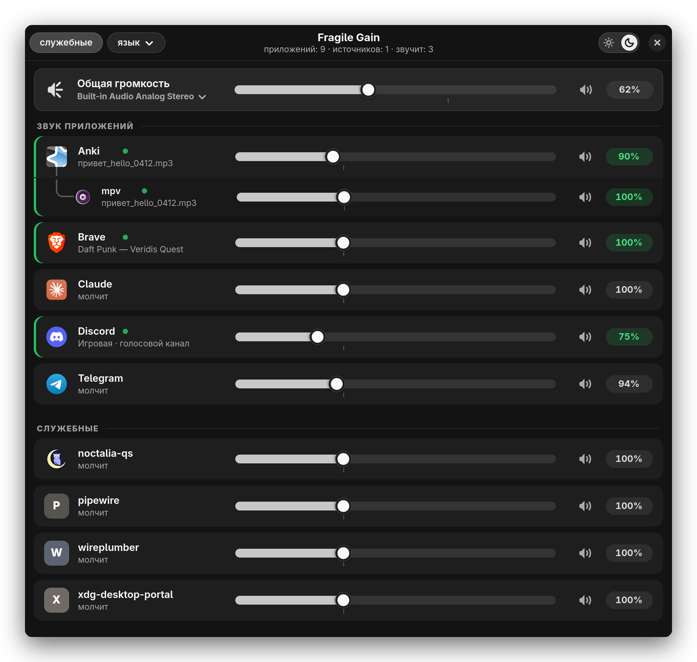 | 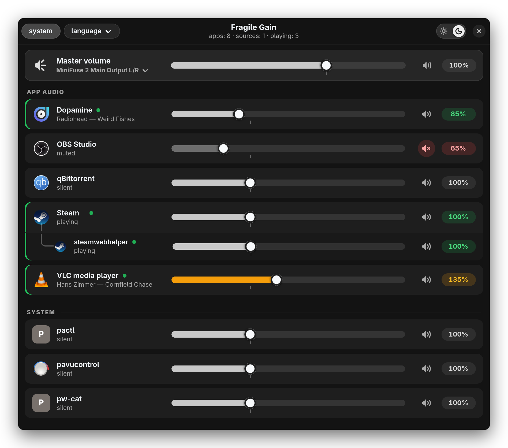 |
| Nested sources (`Anki → mpv`), playing apps, system apps below | English UI: volume above 100 % (amber), mute, `Steam → steamwebhelper` |
| 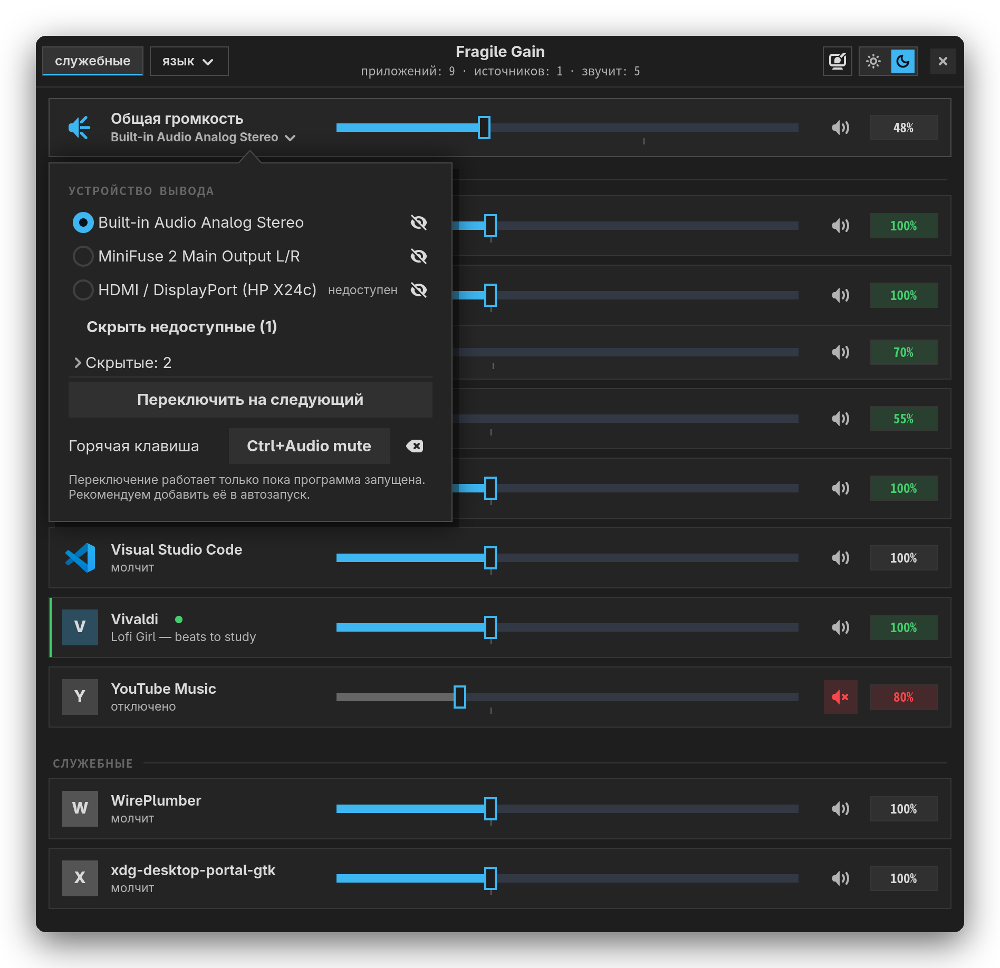 | 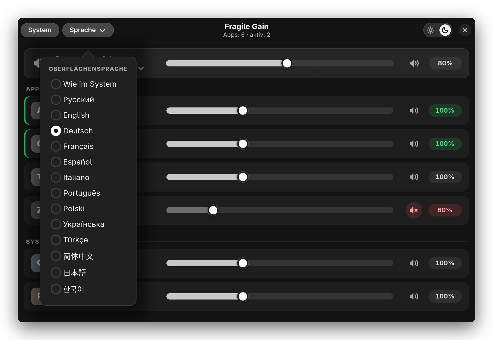 |
| Output menu: select, hide (eye), “unavailable”, hidden, hotkey | Language menu (Deutsch): 13 languages and “System default” |
| 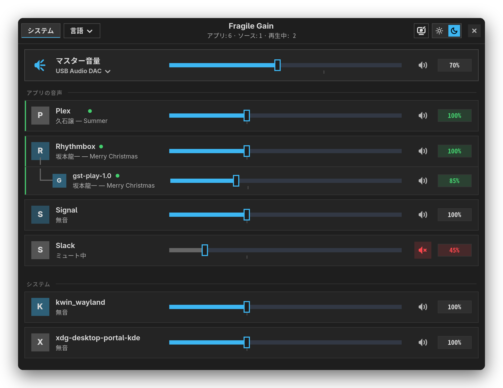 | 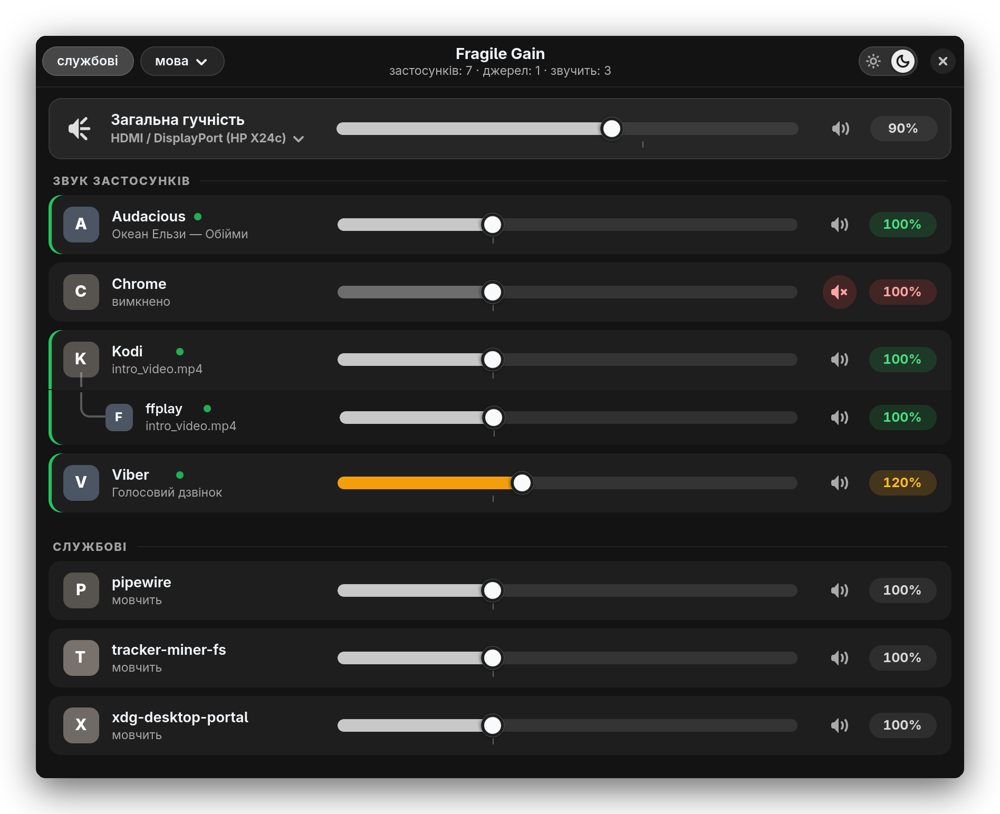 |
| 日本語: `Rhythmbox → gst-play-1.0` | Українська: `Kodi → ffplay`, mute, boost |

</details>

<details>
<summary><b>Light theme</b></summary>

| | |
|:--:|:--:|
|  | 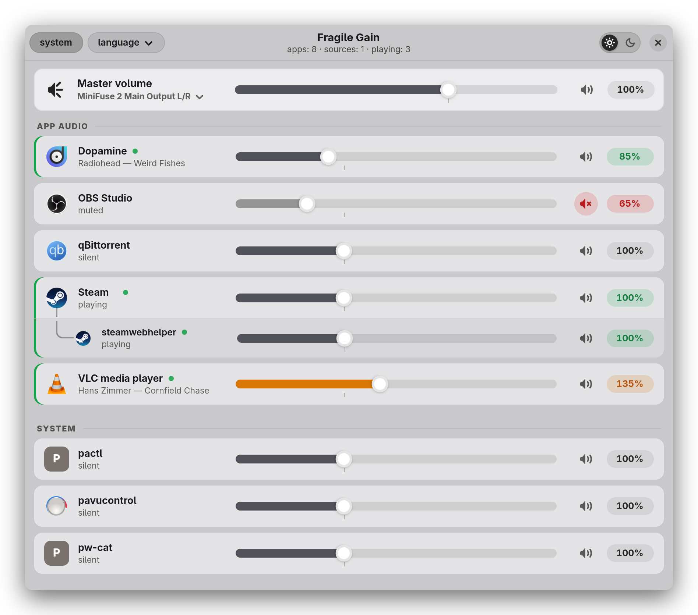 |
| Nested sources (`Anki → mpv`), playing apps, system apps below | English UI: volume above 100 % (amber), mute, `Steam → steamwebhelper` |
| 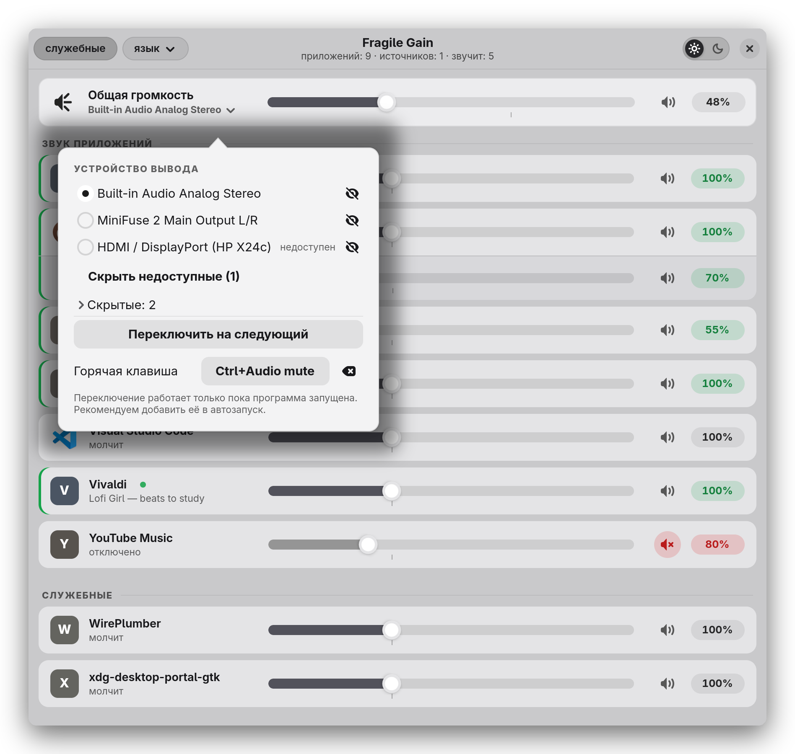 | 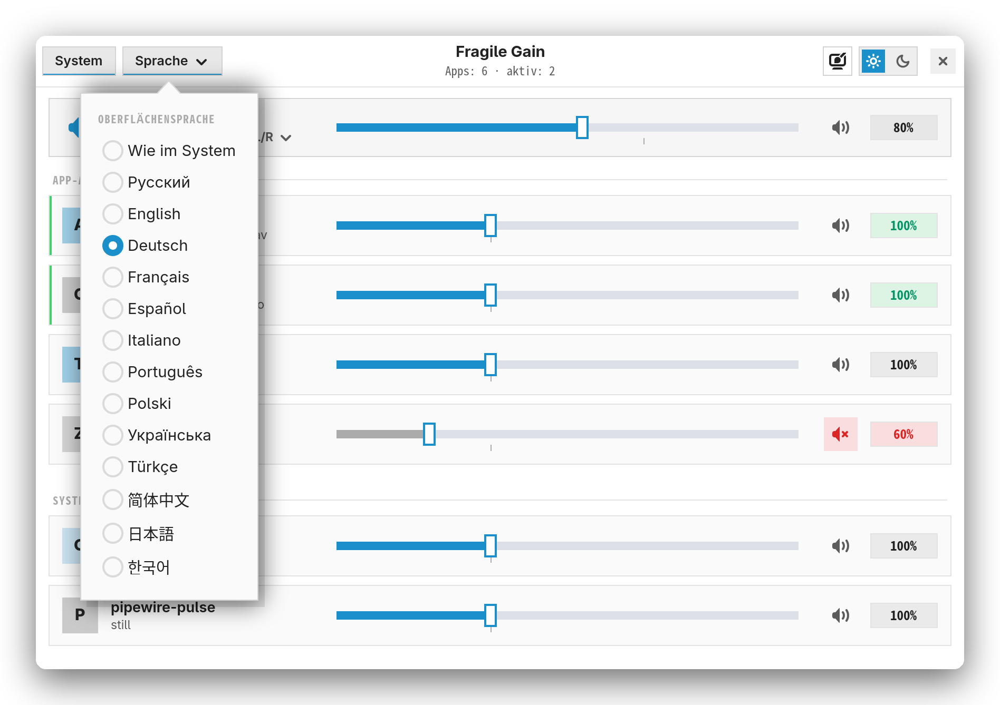 |
| Output menu: select, hide (eye), “unavailable”, hidden, hotkey | Language menu (Deutsch): 13 languages and “System default” |
| 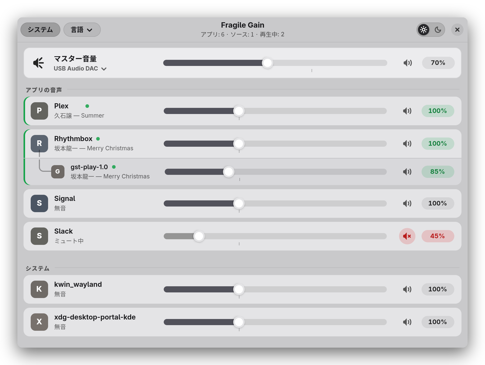 | 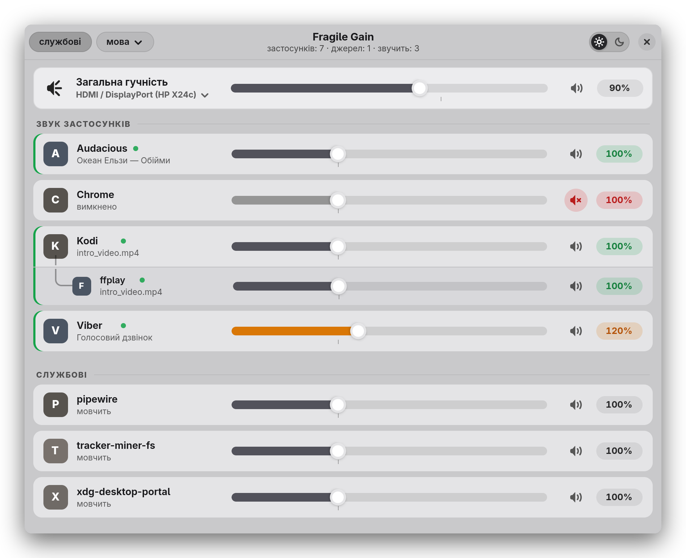 |
| 日本語: `Rhythmbox → gst-play-1.0` | Українська: `Kodi → ffplay`, mute, boost |

</details>

## Install

Requires Linux with **PipeWire** (+ `pipewire-pulse`), Python ≥ 3.9, **GTK ≥ 4.12** and **libadwaita ≥ 1.4**.
The installer checks everything and installs what is missing:

```sh
git clone https://github.com/freakkxd/Fragile-Gain.git
cd Fragile-Gain
./install.sh
```

It installs into your home directory (no root needed; `sudo` is only used for system packages):
`~/.local/share/fragile-gain/` (app, translations, icon; `config/` holds your settings),
`~/.local/bin/fragile-gain` and an application-menu entry.

| Family | Package manager | Tested |
|---|---|---|
| Arch, Manjaro, EndeavourOS, CachyOS… | `pacman` | ✔ Arch Linux |
| Debian, Ubuntu (24.04+), Mint, Pop!_OS… | `apt` | package lists follow distro docs, not tested on live systems |
| Fedora, RHEL-like, Nobara… | `dnf` | same |
| openSUSE Tumbleweed / Leap, SLES | `zypper` | same |
| Others | — | the installer only checks dependencies and tells you what is missing |

```text
./install.sh                    check dependencies, install missing ones, install the app
./install.sh --check            only check, change nothing
./install.sh --yes              no questions (agree to install packages)
./install.sh --no-deps          do not install system packages (still checks)
./install.sh --autostart        start the background mode (--daemon) at login
./install.sh --dry-run          show what would be done
./install.sh --uninstall        remove the app (settings kept; --purge removes them too)
```

Checked: Python ≥ 3.9, PyGObject, GTK ≥ 4.12, libadwaita ≥ 1.4, GdkPixbuf with the SVG loader (librsvg),
`pactl`, `pw-dump`, `pw-cat`, plus (non-critical) `notify-send` and that the audio server is PipeWire.
Older LTS releases often ship GTK/libadwaita that are too old — `./install.sh --check` tells you.

## Usage

Launch **Fragile Gain** from the application menu or run `fragile-gain`. `Esc` closes the window.

```sh
fragile-gain                      # open the window
fragile-gain --list               # table of all apps (debugging)
fragile-gain --set Steam 30       # set 30 % (works for silent apps too)
fragile-gain --set "Anki/mpv" 40  # nested source by row key
fragile-gain --mute Telegram      # mute;  --unmute to restore
fragile-gain --outputs            # list audio outputs
fragile-gain --next-output        # switch to the next visible, available output (--prev-output: previous)
fragile-gain --daemon             # background mode: volume guard for new streams + hotkey via portal (KDE, GNOME 48+)
```

**Output hotkey.** Set it in the output menu (click the device name under "Master volume"). It works while the app is
running. Global keys outside the window depend on your desktop: on KDE Plasma / GNOME 48+ use `fragile-gain --daemon`;
on niri, sway and Hyprland bind the command in the compositor config, e.g. niri:
`Ctrl+XF86AudioMute allow-when-locked=true { spawn-sh "$HOME/.local/bin/fragile-gain --next-output"; }`.

## Volumes do not jump to 100 %

When an app starts playing again the system creates a **new stream at 100 %**, so the sound is briefly at full
volume. The *volume guard* listens to PipeWire events (`pactl subscribe`) and immediately applies the volume and
mute you set for that row to every new stream (re-checking a couple of times, since an app may set its own volume a
moment later). Streams that are already playing are left alone. It works for all apps and nested sources.

The guard runs while the window is open or while the **background mode** `fragile-gain --daemon` is running — add it
to autostart for permanent protection: `./install.sh --autostart` (niri: `spawn-at-startup "fragile-gain" "--daemon"`).

## Settings

`config/ui.json` (theme, language, show system apps), `config/outputs.json` (hidden outputs, hotkey),
`config/volumes.json` (remembered volumes). Translations live in `locales/<code>.json`; to add a language put a
file there and add its code to `LANGUAGES` in `appmixer`.

## Development

```sh
python3 docs/make_screenshots.py                      # regenerate screenshots from demo data
python3 design/gen_wave.py out.svg                    # application icon
python3 design/gen_wave.py out.svg --tray "#ffffff"   # tray mark in a given colour
```

## License

MIT — see [LICENSE](LICENSE).
