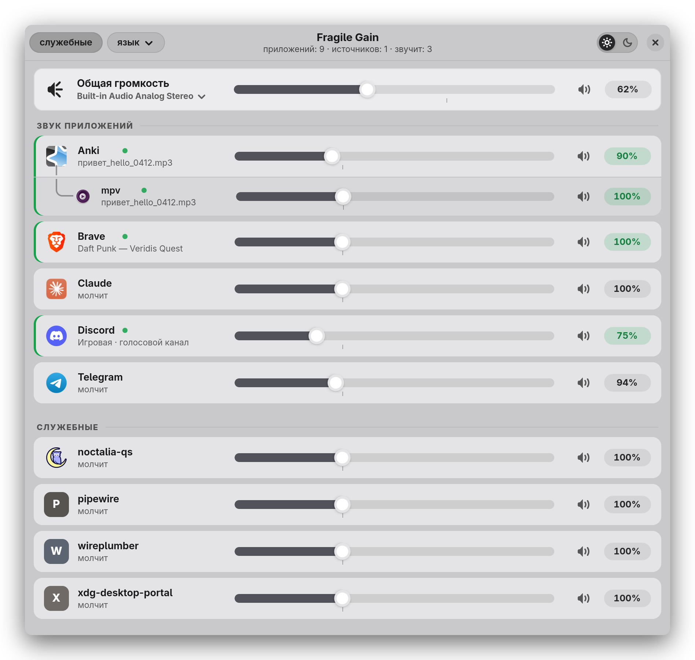
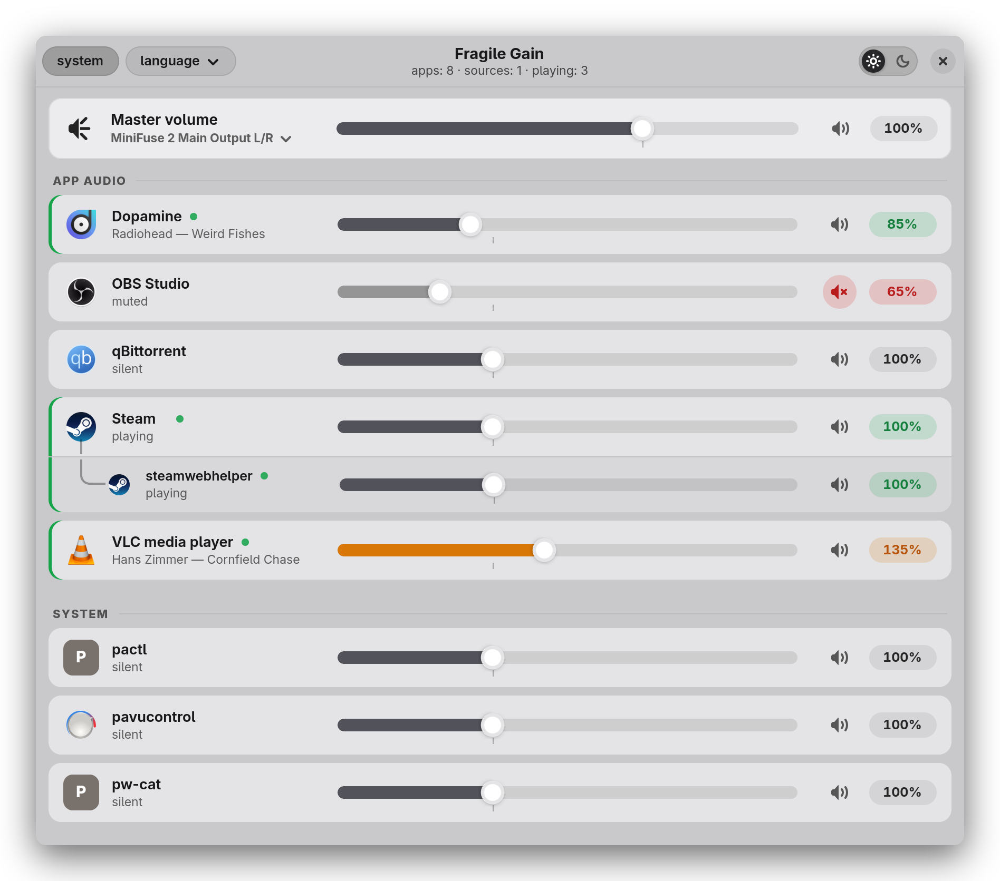
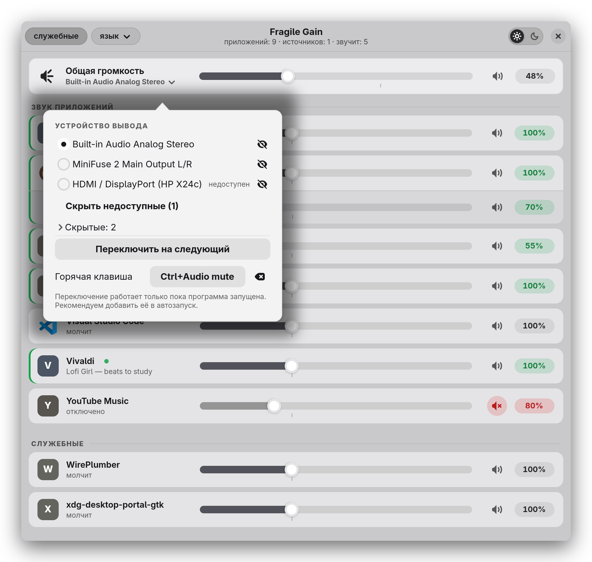
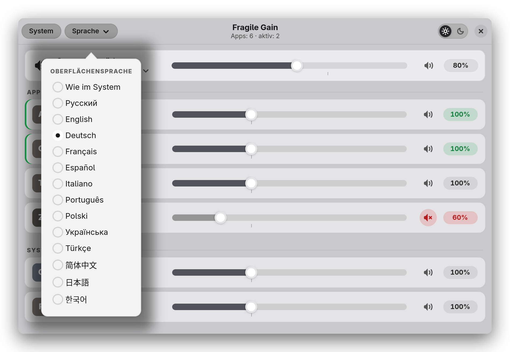
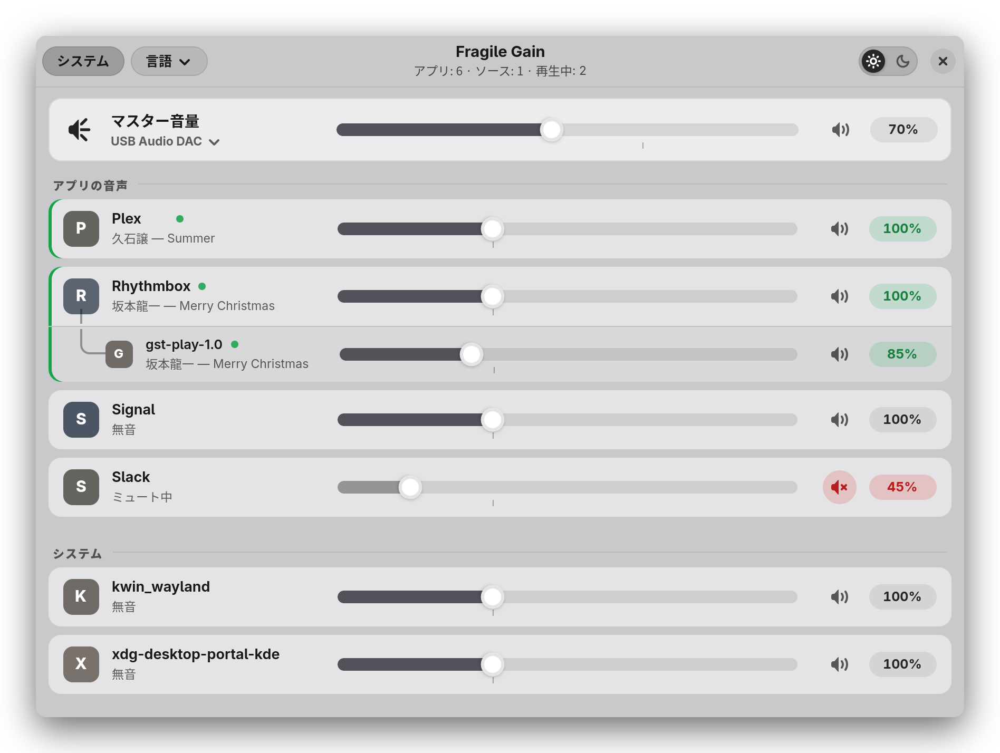
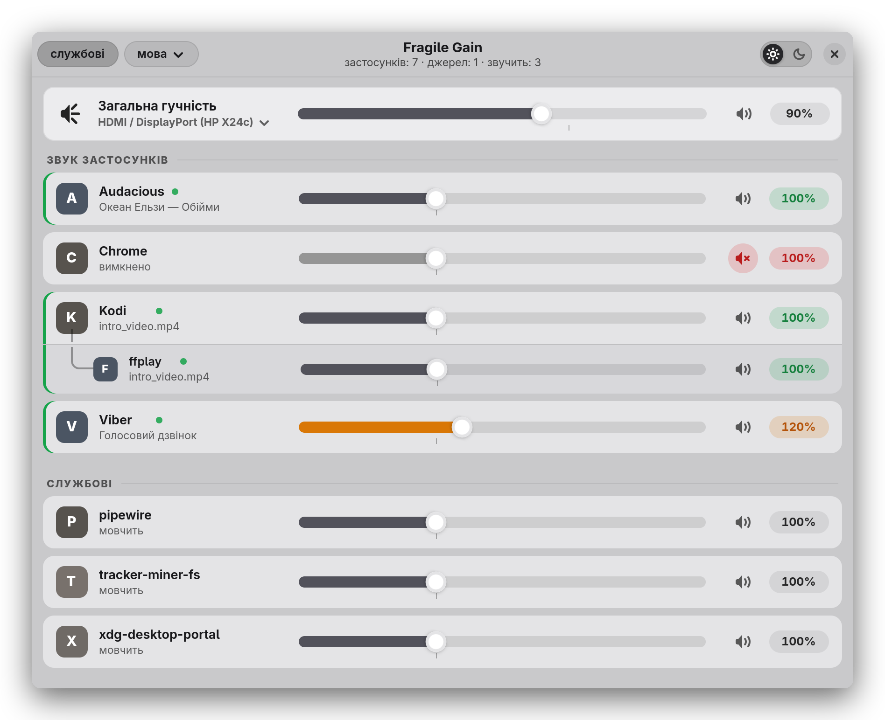

# Fragile Gain

**Микшер громкости по приложениям для PipeWire** — показывает *все* запущенные программы со звуком,
включая молчащие и вложенные источники (`Anki → mpv`), с отдельным ползунком у каждой, общей громкостью,
переключением устройства вывода и интерфейсом на 13 языках.

[English version → README.en.md](README.en.md)

<p align="center">
  
</p>

> Все скриншоты — в светлой теме (тёмная включается переключателем в шапке). Сделаны скриптом [`docs/make_screenshots.py`](docs/make_screenshots.py) на демонстрационных данных
> (приложения, вкладки и устройства — вымышленные), чтобы в кадр не попало ничего личного.

## Зачем он, если есть pavucontrol

pavucontrol, pwvucontrol и wiremix показывают только те приложения, которые **прямо сейчас** проигрывают звук.
В PipeWire громкость принадлежит потоку, а не приложению: замолчал Steam или Telegram — поток уничтожен,
и ползунка для них нет. Поэтому в обычном микшере видно 1–2 строки вместо всех запущенных программ.

Fragile Gain показывает **все запущенные приложения, которые используют звук**, включая молчащие и висящие
в трее. У каждого — свой ползунок и кнопка мьюта, а громкость запоминается и применяется, когда приложение
зазвучит.

## Возможности

- **Дерево зависимостей:** если звук издаёт не само приложение, а его «рука» (Anki запускает `mpv`), источник
  показывается вложенной строкой с отводом, как дерево файлов. Ползунок родителя двигает всех вложенных на
  ту же разницу (Anki −5 % → mpv −5 %).
- **Настоящие имена и иконки** из установленных приложений (`.desktop`), служебные процессы — отдельным разделом.
- **Что играет:** под названием — заголовок вкладки браузера или трека (через MPRIS), имя файла у mpv;
  «молчит» / «отключено» для остальных состояний.
- **Общая громкость** текущего выхода, **смена устройства вывода** с переносом играющих потоков,
  **скрытие «мёртвых» выходов** (чтобы хоткей не переключал на отключённый HDMI) и **горячая клавиша**.
- Громкость **выше 100 %** (до 300 % у приложений, до 150 % у общей), подсветка звучащих, мьют, колесо мыши.
- Светлая и тёмная темы (переключатель в шапке), 13 языков (язык системы подхватывается автоматически, переключается кнопкой «язык»).
- Доступность: клавиатура, доступные имена элементов для скринридеров.

## Скриншоты

| | |
|:--:|:--:|
|  |  |
| Дерево `Anki → mpv`, играющие приложения, служебные внизу | English: громкость выше 100 % (янтарный), мьют, `Steam → steamwebhelper` |
|  |  |
| Меню устройства вывода: выбор, «скрыть» (глаз), «недоступен», скрытые, горячая клавиша | Меню языка (Deutsch) — 13 языков и «Как в системе» |
|  |  |
| 日本語: `Rhythmbox → gst-play-1.0` | Українська: `Kodi → ffplay`, мьют, буст |

## Установка

Нужны Linux с **PipeWire** (+ слой совместимости `pipewire-pulse`), Python ≥ 3.9, **GTK ≥ 4.12** и
**libadwaita ≥ 1.4**. Установщик сам всё проверит и доустановит недостающее:

```sh
git clone https://github.com/freakkxd/Fragile-Gain.git
cd Fragile-Gain
./install.sh
```

Установка идёт в домашний каталог (root не нужен, `sudo` попросят только для системных пакетов):

| Куда | Что |
|---|---|
| `~/.local/share/fragile-gain/` | программа, переводы, иконка; `config/` — ваши настройки |
| `~/.local/bin/fragile-gain` | команда запуска |
| `~/.local/share/applications/ru.fragilich.appmixer.desktop` | запись «Fragile Gain» в меню приложений |

| Семейство | Менеджер пакетов | Проверено |
|---|---|---|
| Arch, Manjaro, EndeavourOS, CachyOS… | `pacman` | ✔ Arch Linux |
| Debian, Ubuntu (24.04+), Linux Mint, Pop!_OS… | `apt` | наборы пакетов по документации дистрибутива, на живой системе не проверялись |
| Fedora, RHEL-подобные, Nobara… | `dnf` | то же |
| openSUSE Tumbleweed / Leap, SLES | `zypper` | то же |
| Остальные | — | установщик только проверяет зависимости и говорит, чего не хватает |

Если на вашем дистрибутиве что-то не встало, `./install.sh --check` покажет, чего именно не хватает
(версии GTK/libadwaita старше требуемых — самая частая причина на LTS-системах). Об ошибках в списках пакетов
напишите в Issues.

Параметры установщика:

```text
./install.sh                    проверить зависимости, доустановить недостающее, установить
./install.sh --check            только проверить, ничего не менять
./install.sh --yes              без вопросов (согласиться на установку пакетов)
./install.sh --no-deps          не ставить системные пакеты (проверка остаётся)
./install.sh --dry-run          показать, что было бы сделано
./install.sh --distro debian    считать дистрибутив debian|arch|fedora|suse (для проверки)
./install.sh --uninstall        удалить программу (настройки остаются; --purge — и настройки)
```

Что проверяется: Python ≥ 3.9, PyGObject, GTK ≥ 4.12, libadwaita ≥ 1.4, GdkPixbuf с загрузчиком SVG (librsvg),
команды `pactl`, `pw-dump`, `pw-cat`, а также (не критично) `notify-send` и то, что звуковой сервер — PipeWire.

## Запуск

Из меню приложений («Fragile Gain») или командой `fragile-gain`. Окно закрывается по `Esc`.
Хорошо работает как всплывающая панель по горячей клавише — привяжите команду в вашем окружении.
Например, в **niri** (`~/.config/niri/config.kdl`):

```kdl
Shift+XF86AudioMute { spawn-sh "$HOME/.local/bin/fragile-gain"; }

window-rule {
    match app-id=r#"^ru\.fragilich\.appmixer$"#
    open-floating true
    default-column-width { proportion 0.46; }
}
```

### Из командной строки

```sh
fragile-gain                      # открыть окно
fragile-gain --list               # таблица всех приложений (отладка)
fragile-gain --set Steam 30       # задать 30 % (работает и для молчащего)
fragile-gain --set "Anki/mpv" 40  # вложенный источник — по ключу строки
fragile-gain --mute Telegram      # заглушить;  --unmute — вернуть звук
fragile-gain --outputs            # список аудиовыходов (* — текущий, hidden/dead — пометки)
fragile-gain --next-output        # переключить на следующий видимый и доступный выход
fragile-gain --prev-output        # …на предыдущий
fragile-gain --daemon             # фоновый хоткей через xdg-desktop-portal (KDE Plasma, GNOME 48+)
```

## Как это работает

### Дерево: приложение → чем оно звучит

Звук издаёт не само приложение, а его «рука»: Anki запускает `mpv`, свой софт может звать `mpv`, `ffplay`,
браузерный рендерер. Программа находит связи по дереву процессов (`anki → mpv`) и показывает источник
вложенной строкой:

```
Anki                      ← корневое приложение
   └ mpv                  ← то, что реально звучит
```

- Ползунок корневой строки двигает собственный поток приложения и все вложенные источники **на ту же разницу**.
  Ползунок вложенной строки двигает только свой поток. Если `mpv` работает и в Anki, и в другом приложении, строк
  будет две (`Anki/mpv`, `МойСофт/mpv`) с независимыми ползунками.
- Если подпись вложенного совпадает с корнем (рендерер Brave и сам Brave) — это одно приложение, строка одна.
- Терминалы, оболочки, лаунчеры и сессия (`bash`, `kitty`, `niri`, `systemd`, `flatpak`…) в дерево не берутся:
  `mpv` из терминала остаётся корнем, а `mpv`, порождённый Anki, вкладывается в Anki.

### Иконки и имена

Берутся из установленного приложения — `.desktop` в `/usr/share/applications`, `~/.local/share/applications`,
flatpak/snap. Если ничего не нашлось (служебные процессы), рисуется первая буква на цветном фоне. Иконки
обрезаются по видимому содержимому и вписываются в одинаковый квадрат, поэтому у всех один размер.

### Строки не пропадают

- Приложение с **постоянным клиентом** в аудиосервере (Telegram, Brave, …) висит всегда, даже в тишине.
- Приложение без клиента (mpv) запоминается по бинарнику в `config/volumes.json` — после первого звука
  строка остаётся и молчащей.
- Потоки **без имени и pid** (звуки уведомлений, «Playback Stream») подвязываются к владельцу: программа
  спрашивает у PipeWire (`pw-dump`) клиента потока и берёт его `application.process.id`.

### Громкость молчащего приложения

- **Звучит** → меняется мгновенно через `pactl set-sink-input-volume` (ровно по потокам строки).
- **Молчит** → на 1,5 с запускается беззвучный поток `pw-cat` с «паспортом» приложения (`application.name`
  или `application.id`), громкость выставляется ему; WirePlumber запоминает её и применит, когда приложение
  зазвучит. Фоновых демонов нет.

### Громкость выше 100 %

«Потолка» нет: шкала 0…300 %, колесом — за любой предел. Значения в той же шкале, что у `pactl`/`pavucontrol`.
Колесо над ползунком — шаг 2 % (с `Ctrl` — 10 %); над остальной строкой оно листает список.

### Подпись под названием

1. **молчит** — приложение не воспроизводит звук;
2. **название играющего** — заголовок вкладки браузера или трека (MPRIS), имя файла (mpv и подобные);
3. **отключено** — строка заглушена. Длинное название прокручивается, как на старых плеерах.

### Устройство вывода, «мёртвые» выходы и горячая клавиша

- В карточке «Общая громкость» под названием — кнопка с текущим выходом. Меню: все выходы (выбор переключает
  системный выход **и переносит играющие потоки**), у каждого кнопка «скрыть» (глаз) — скрытый выход пропадает
  из списка и из переключения по хоткею; скрытые — в блоке «Скрытые» с кнопкой «показать».
- Выходы без подключённого устройства помечены «недоступен»; «Скрыть недоступные» убирает их разом.
  Список скрытых — в `config/outputs.json`.
- «Переключить на следующий» и `--next-output` идут по кругу только по видимым и доступным выходам.
- **Горячая клавиша** настраивается там же: «Горячая клавиша» → нажать сочетание (по умолчанию
  `Ctrl+XF86AudioMute`; `Esc` — отмена, значок справа — сбросить). Сочетание работает, пока программа запущена,
  поэтому её стоит добавить в автозапуск.
- Глобальные клавиши вне окна зависят от окружения: в **KDE Plasma и GNOME 48+** работает `fragile-gain --daemon`
  (портал GlobalShortcuts); в **niri, sway, Hyprland** портал не поддерживается — привяжите команду
  `fragile-gain --next-output` в конфиге компоновщика, например в niri:
  `Ctrl+XF86AudioMute allow-when-locked=true { spawn-sh "$HOME/.local/bin/fragile-gain --next-output"; }`.

### Языки

Язык системы подхватывается при запуске (`LANGUAGE` / `LC_ALL` / `LANG`), иначе английский. Кнопка «язык»
меняет язык сразу. Есть: русский (исходный), English, Deutsch, Français, Español, Italiano, Português, Polski,
Українська, Türkçe, 简体中文, 日本語, 한국어. Переводы — `locales/<код>.json`; чтобы добавить язык, положите файл
и добавьте код в список `LANGUAGES` в программе (`locales/_source.json` — ключи с пометками для переводчика).
Строки командной строки не переводятся.

## Файлы и настройки

| Путь | Что |
|---|---|
| `appmixer` | сама программа (один файл: Python + GTK 4 + libadwaita) |
| `config/volumes.json` | выставленная громкость, «паспорта» приложений и их бинарники |
| `config/ui.json` | тема, язык, показ служебных |
| `config/outputs.json` | скрытые выходы и горячая клавиша |
| `locales/` | переводы |
| `data/` | беззвучный файл для «фантомных» потоков, иконка |
| `install.sh` | установщик |
| `design/`, `data/tray/` | генераторы логотипа и готовые знаки для трея (прозрачные SVG/ICO, светлый и тёмный) |
| `docs/` | скрипт скриншотов и сами скриншоты |
| `~/.local/state/wireplumber/stream-properties` | память WirePlumber по приложениям (системная, не наша) |

## Особенности и ограничения

- Приложения, которые ни разу не обращались к звуку и которых нет в списке известных (только что запущенная
  молчащая игра), в списке не появятся; после первого звука микшер запомнит их.
- Приложения, ходящие мимо PipeWire в ALSA/JACK, видны не всегда.
- Группировка идёт по подписи приложения: Discord со всеми своими потоками — одна строка.
- Общие имена (`Chromium input` у Steam, Dopamine, Discord) при задании громкости молчащему приложению не
  затрагиваются, чтобы не убавить соседа.
- Два **молчащих** экземпляра одного приложения (два mpv без звука) в памяти WirePlumber неразличимы — она
  ведётся по имени/id, а не по процессу; пока у них есть потоки, каждый ползунок бьёт по своему.
- Ширину окна задаёт компоновщик, высоту микшер подгоняет сам; длинный список прокручивается.
- Глобальный хоткей на compositor'ах без GlobalShortcuts — только через bind в их конфиге (см. выше).
  Фоновый режим `--daemon` проверен лишь до отказа портала в niri; на KDE/GNOME не тестировался.

## Разработка

```sh
python3 docs/make_screenshots.py            # перегенерировать скриншоты (демо-данные, настройки не трогает)
python3 design/gen_wave.py out.svg          # иконка приложения
python3 design/gen_wave.py out.svg --tray "#ffffff"   # знак для трея заданного цвета
```

Дизайн подобран по скиллу ui-ux-pro-max (Data-Dense Dashboard, серая палитра); цвета обеих тем — словарь `THEMES`
в `appmixer`.

## Удаление

```sh
./install.sh --uninstall           # программа, команда, меню, иконка (настройки остаются)
./install.sh --uninstall --purge   # …вместе с настройками
```

## Лицензия

Лицензия пока не выбрана: пока в репозитории нет файла `LICENSE`, по умолчанию все права защищены автором.
